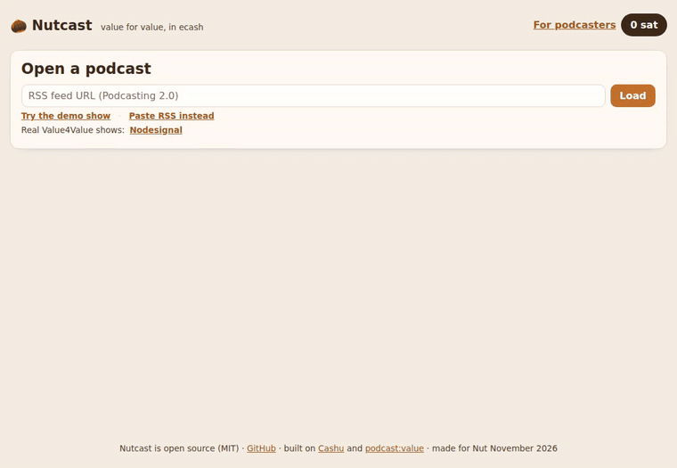
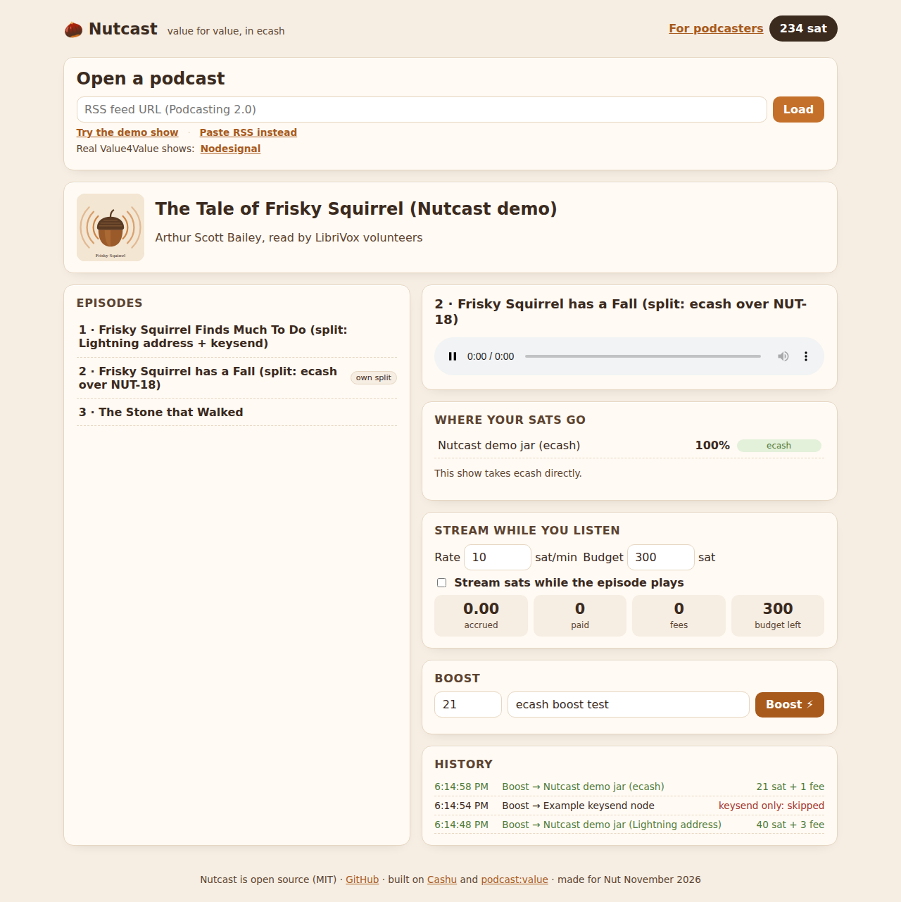
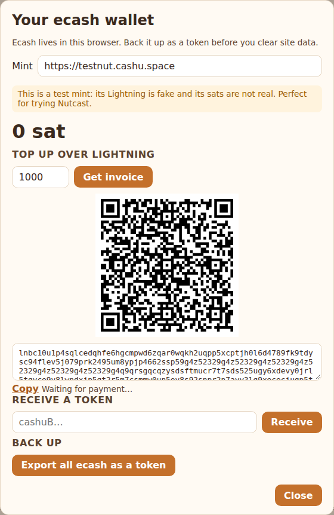
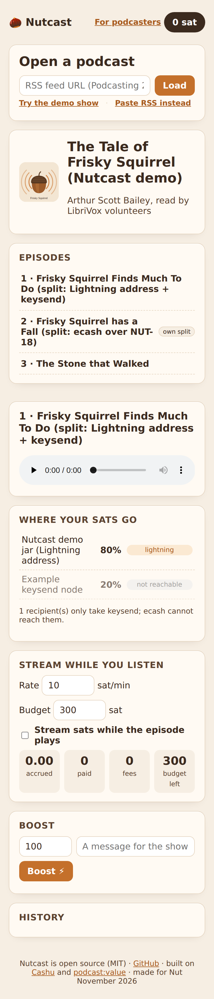
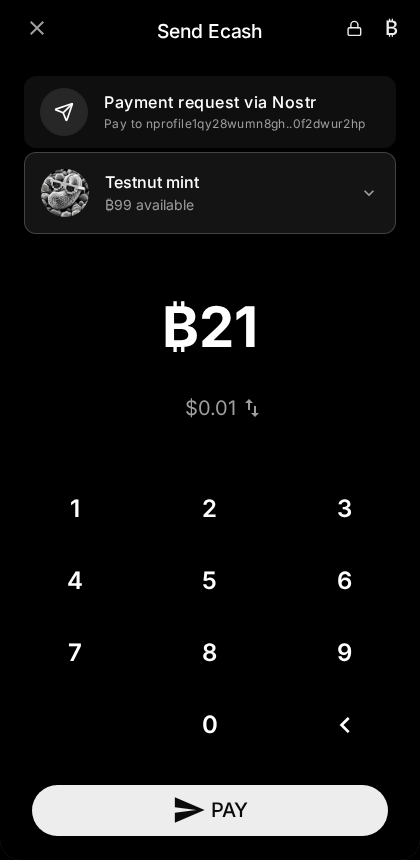
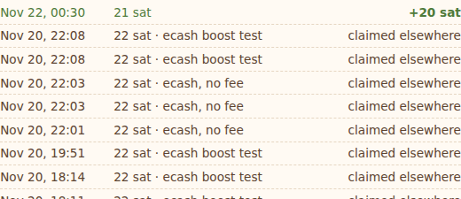

# Nutcast

**Value4Value for any podcast, paid from a Cashu wallet in your browser.**

**Live demo:** https://mmajjd926-netizen.github.io/nutcast/ (press *Try the demo show*; the default mint is the
test mint `testnut.cashu.space`, so top-ups are free and nothing is real money).

**Real show:** [Nodesignal in Nutcast](https://mmajjd926-netizen.github.io/nutcast/?feed=https%3A%2F%2Fserve.podhome.fm%2Frss%2Fe8df0b13-47de-544a-99b7-ec7cbd960a16).
Its feed and its Lightning addresses allow browser requests, so the whole path runs from the page: every episode's
split (host + guest Lightning addresses) is read and paid. On the test mint the melt is simulated; pick a real mint
in the wallet (Minibits, Macadamia, Voltz are suggested) and the same boost is real.

Nutcast is a podcast player that reads a feed's Podcasting 2.0 value split (`<podcast:value>`) and lets listeners
**stream sats per minute** and **send boosts with a message**, paid from an ecash wallet that lives in the page.
No node, no channel, no account, no server of ours: it is a static site.



*Top up on the test mint → boost a Lightning-address split → boost an ecash split over NUT-18 (no Lightning fee) →
the podcaster opens their inbox and the ecash lands in their wallet. Recorded headless with `tools/demo-video.mjs`.*

| Player | Wallet top-up | On a phone |
|---|---|---|
|  |  |  |

## Why

Value4Value today needs the listener to run a Lightning node or keep money in a custodial app that speaks keysend.
Most listeners have neither, so most of them never send a sat. Ecash fixes the listener side: a Cashu wallet is a
few kilobytes in the browser, funded with one Lightning invoice. Nutcast then pays the split the podcaster
already published:

- **Lightning-address recipients** (`type="lnaddress"`) are paid through the mint: LNURL-pay (LUD-06/16, with the
  boost message as a LUD-12 comment) → bolt11 → NUT-05 melt. Nutcast checks that the invoice asks for exactly the
  amount it requested before paying. Streams are **batched** (default: settle at 21 sat per recipient) because
  every melt reserves a Lightning fee.
- **Keysend recipients** (`type="node"`) cannot be reached from ecash. Their share is shown as *not reachable* and
  **never redistributed** to the others: the podcaster's split stands, the listener simply pays less.
- **Cashu recipients**, a small proposal below, receive ecash directly. No Lightning hop, so no routing fee and no
  fee reserve: streaming can settle **every minute, down to 1 sat**, and the payment is private (NIP-17 gift wrap).

## Proposal: a `cashu` value block

The `podcast:value` tag already allows other `type`s than `lightning`. Nutcast reads this one:

```xml
<podcast:value type="cashu" method="nut18" suggested="0.00000010000">
  <podcast:valueRecipient name="Host" type="paymentrequest" address="creqA…" split="90"/>
  <podcast:valueRecipient name="Producer" type="paymentrequest" address="creqA…" split="10"/>
</podcast:value>
```

- `address` is a [NUT-18](https://github.com/cashubtc/nuts/blob/main/18.md) payment request with **no amount**
  (the player fills it in), unit `sat`, optionally a list of mints the recipient accepts, and a transport.
  Nutcast supports both NUT-18 transports: **Nostr** (NIP-17 private message to the recipient's npub, the default)
  and **HTTP POST**.
- The boost or stream message travels as the NUT-18 payload `memo`.
- Split math is the same as for Lightning: `fee="true"` recipients take their percentage off the top, the rest is
  shared by `split` weight, remainders go by largest remainder, so the sats always add up.
- A feed can carry a `cashu` block **next to** its `lightning` block. Players that know ecash use the cashu one;
  every other player keeps working with the lightning one. Nothing breaks.

The podcaster's side is one paste: the **For podcasters** page in Nutcast turns an npub (plus the relays and mints
they want) into the `creqA…` request and the whole XML block. The same page has an **inbox**: sign in with a NIP-07
extension (the key never leaves it) or a key kept in the browser, press *Check for payments*, and every NIP-17 gift wrap
carrying ecash is opened and received into the page's wallet (each mint keeps its own balance). Any other Cashu wallet
that reads NUT-18 over Nostr works too.

Discussion in the Podcasting 2.0 namespace: [podcast-namespace#798](https://github.com/Podcastindex-org/podcast-namespace/discussions/798).

Episode 2 of the demo show uses such a block. Episode 1 uses a classic Lightning address + keysend split.

## What works

- Any RSS feed by URL (if the host allows cross-origin reads) or pasted XML; channel and item value blocks
  (item overrides channel); `suggested` sets the default stream rate.
- The feed's `suggested` rate starts the stream slider, capped at 100 sat/min (some feeds suggest 21 000).
- Wallet on any mint: NUT-04 top-up with QR, receive a pasted token, NUT-05 melt (with a NUT-07 state check that puts proofs back if a melt fails), and
  **back up** = every proof exported as one token without a swap. Proofs live in `localStorage`.
- Streaming counts only real listening: the media clock while playing, no seeks, no jumps; per-recipient
  accrual in millisats; session **budget** that caps what is really paid (unreachable shares do not eat it).
- Boosts split the same way and report each recipient's result, fee included.
- **Boost from your own wallet, nothing held by the page:** one QR per recipient, a bolt11 invoice for each Lightning address
  (the message as LUD-12 comment) and the recipient's own NUT-18 request with the share filled in as its amount.
  Any Lightning or Cashu wallet pays them; the app never touches a token. This is how an app that does not want to
  hold ecash can still pay `type="cashu"` recipients today (see [the discussion in podcast-namespace](https://github.com/Podcastindex-org/podcast-namespace/discussions/798)).
- Podcaster inbox: finds NIP-17 gift wraps for the key, checks the seal signature and that rumor and seal share the
  sender, reads the NUT-18 payload and receives it; a failed receive (mint offline) is retried next time, spent proofs are not.
- Several mints: ecash is received at the mint the listener paid from, so the wallet lists every mint it holds sats at
  and switches to one in a click. Each mint keeps its own proofs and its own pending top-ups.
- **Works with cashu.me** (checked 2026-11-21): a podcaster request from Nutcast, with 21 sat filled in, pasted into
  [cashu.me](https://wallet.cashu.me) is recognised as "Payment request via Nostr"; cashu.me sends it, and the
  Nutcast inbox finds the gift wrap and receives the ecash (21 sat sent, 20 sat after the test mint's 1 sat input fee).
  No shared code between the two wallets, only NUT-18 and NIP-17.

   
- Feed text is never rendered as HTML.

## How it is built

TypeScript, Vite, [`@cashu/cashu-ts`](https://github.com/cashubtc/cashu-ts) 4.x, `nostr-tools`. The logic is in
`src/core/` and has no DOM dependency:

| file | what |
|---|---|
| `value.ts` | parse feeds and value blocks, split math |
| `wallet.ts` | ecash wallet over cashu-ts: top-up, receive, send, melt, NUT-18 payloads, backup |
| `lnurl.ts` | LNURL-pay with an amount check on the bolt11 |
| `nostr.ts` | NIP-17 delivery of NUT-18 payments |
| `inbox.ts` | the receiving side: open gift wraps (NIP-07 or local key), read ecash payments |
| `stream.ts` | accrual, budget, batched settlement, boosts |
| `payer.ts` | glue: Lightning addresses via melt, payment requests via ecash |

```bash
npm install
npm test                                   # unit tests (value, streaming)
NUTCAST_LIVE=1 npx vitest run              # + wallet against testnut.cashu.space (fake Lightning)
npm run dev
```

`tools/e2e.mjs` and `tools/e2e-stream.mjs` drive the built site in headless Chromium: demo feed → top-up → boost
to a Lightning address → ecash boost over Nostr → the podcaster's inbox receives it → real playback with streaming on.

## Limits, honestly

- Ecash is custodial: the mint holds the sats. Keep small amounts in a player wallet, and pick a mint you trust.
- Browser storage is the wallet. Clearing site data without a backup loses the ecash.
- A Nostr-delivered payment is final once a relay accepts it; if the recipient never reads it, the sats sit in
  their inbox. That is the NUT-18 Nostr transport's model, not something Nutcast can fix.
- Many podcast hosts block cross-origin feed reads; then paste the XML.

Built for [Nut November](https://nutnovember.org) 2026. License: MIT.
